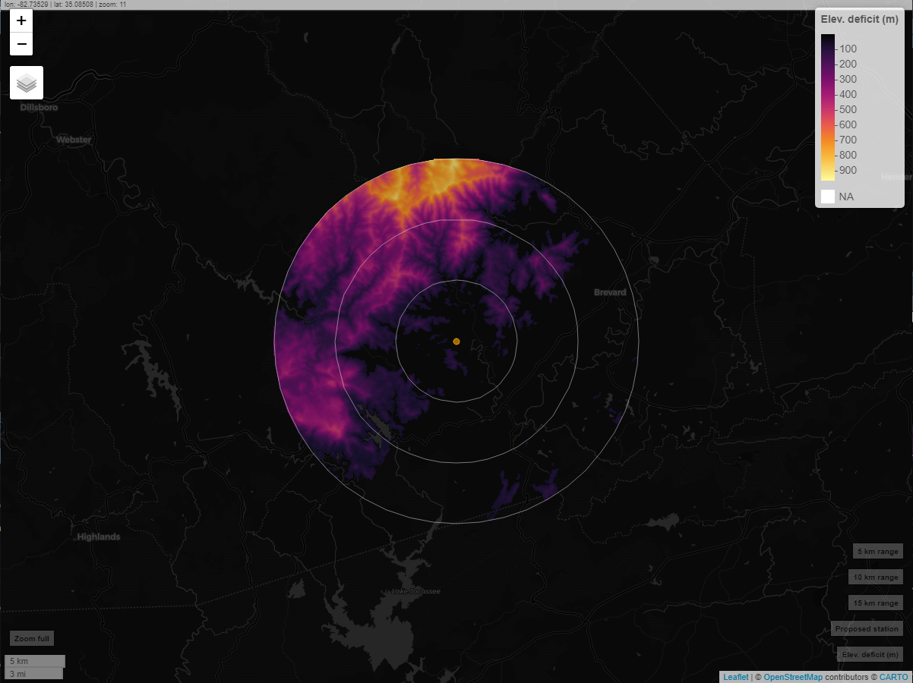

<!-- badges: start -->
[](https://mybinder.org/v2/gh/adamdsmith/motus_viewshed/master?urlpath=rstudio)
<!-- badges: end -->

Click the `launch binder` badge above open and run RStudio in your browser (`CTRL`/`CMD` + click for new tab), provided courtesy of [mybinder.org](https://mybinder.org/). It may take a moment to build and open.

------

### Load functionality

With RStudio operational, load the viewshed generating function with:

``` r
source("R/motus_viewshed.R")
```

### Find the coordinates of your proposed Motus station

If you don't know them already, use a map service (e.g., [Google Maps](https://maps.google.com)) to find the geographic coordinates of your proposed station (latitude and longitude, in decimal degrees). This will be provided to the `motus_viewshed` function as a vector of the form `c(latitude, longitude)`. Here we illustrate using the coordinates of the Motus station at the Pisgah Astronomical Research
Institute in Rosman, NC.

### Estimate the height of the receiving antennas when installed

Estimate the height of the antennas, in meters, at the existing/proposed station. You can also leave this at the default value (`ht = 0`), to get a sense of how high antennas may need to be installed based on the surrounding landscape. Here, we use the installed height of the antennas (6 meters).

### Execute the viewshed function

Pass these parameters to the `motus_viewshed` function, and *voila*, a fully interactive viewshed for your inspection (note, the image below is not interactive on Github):

``` r
motus_viewshed(coords = c(35.196986, -82.873250), ht = 6)
```




If you're doing many of these, there's an abbreviated version `mv()` that's easier to type and copy-paste coordinates into. Here's the same viewshed using the abbreviated version:

``` r
mv(35.196986, -82.873250, 6)
```


### CARTO Dark Matter basemap

The dark basemap uses a free CARTO Basemaps API key. For local R sessions, set `CARTO_API_KEY` in your own `.Renviron` (do not commit the key), restart R, and use `mv()` as usual. Without a key, the map uses Esri World Gray Canvas plus the other existing basemaps.

**Public Binder:** mybinder.org does not inject repository secrets into public sessions. To provide CARTO automatically to all Binder visitors, a *dedicated public-client key* would have to be distributed with the public project (for example, in a separate source file), meaning anyone can inspect and reuse it. Do not publish a credential that must remain private. CARTO's free noncommercial plan stops tile delivery at its quota rather than billing overages. Configure Referer restrictions when practical and monitor use in the CARTO dashboard.
